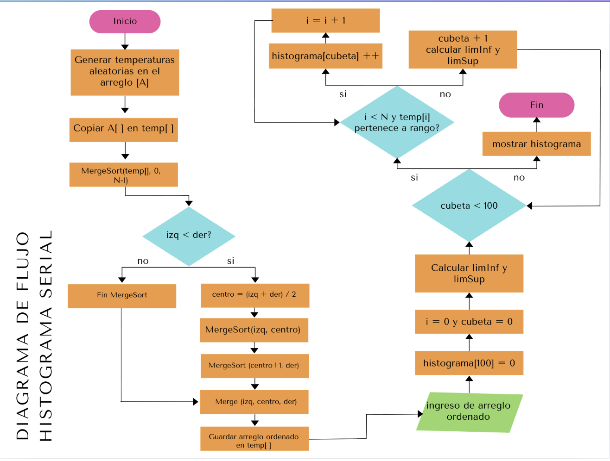

# Paso 1. Análisis de la solución secuencial existente

> Responsable: Marinés García · Código analizado: `original_c/histograma.c` (Evaluación Corta 2)
> y su traducción a Python `secuencial/histograma_seq.py`, que es la línea base del proyecto.

## 1.1 Descripción general

El programa genera **N temperaturas aleatorias** en el rango [-100, 100] °C con dos decimales,
las **ordena con MergeSort** y construye un **histograma de 100 cubetas** de igual ancho.
Como el arreglo ya está ordenado, el histograma se arma con **un solo recorrido**: se avanza por
los datos y se pasa a la cubeta siguiente cuando un valor sale del rango de la actual.
Al final se escriben tres archivos: las temperaturas ordenadas (`.csv`), las frecuencias (`.dat`)
y la gráfica (`.png`).

*Figura 1. Diagrama de flujo de la versión secuencial (Evaluación Corta 2).*

## 1.2 Partes principales del programa

| Parte | En el C original | En Python | Función |
|---|---|---|---|
| Configuración | `#define MAX`, `#define CUBETAS`, variables globales | `comun/config.py` | Define el tamaño máximo, las 100 cubetas y los arreglos de trabajo (`A[]`, `temp[]`, `tempAux[]`, `histograma[]`). |
| Entrada | `scanf("%d", &N)` | argumento `n` de `ejecutar()` | Recibe cuántas temperaturas procesar. |
| Generación de datos | ciclo con `rand()` en `main` | `comun/datos.py` → `generar_secuencial()` | Llena el arreglo con temperaturas aleatorias: `-100 + (aleatorio % 20001) / 100`. En Python se usa una semilla fija para que la versión secuencial y la paralela procesen **los mismos datos**. |
| Copia de trabajo | `temp[i] = A[i]` | `ordenar()` → `datos.tolist()` | Copia el arreglo original para ordenar la copia sin perder los datos originales. |
| Ordenamiento | `MergeSort()` | `merge_sort()` | Divide recursivamente el arreglo en mitades hasta llegar a subarreglos de 1 elemento. |
| Fusión | `Merge()` | `merge()` | Combina dos mitades ordenadas en una sola, usando el arreglo auxiliar `tempAux[]`, y copia el resultado de regreso. |
| Límites | inicio de `Histograma()` | `limites()` | Toma el mínimo (`temp[0]`) y el máximo (`temp[N-1]`) del arreglo ordenado y calcula `ancho = (max - min) / 100`. |
| Histograma | `Histograma()` | `histograma()` | Recorre el arreglo ordenado una sola vez y cuenta cuántos valores caen en cada cubeta. |
| Escritura | `fprintf` a `.csv` y `.dat` | `escribir_csv()`, `escribir_dat()` | Guarda las temperaturas ordenadas y la frecuencia de cada cubeta. |
| Gráfica | `popen("gnuplot")` | `graficar()` (matplotlib) | Genera `histograma.png`. Se cambió a matplotlib porque Colab no tiene gnuplot. |

## 1.3 Descomposición en operaciones

Desde la recepción de los datos hasta la obtención del resultado:

| No. | Operación identificada | Descripción de su funcionamiento |
|---|---|---|
| 1 | Recepción de N | Se recibe la cantidad de temperaturas a procesar y se valida que no exceda el máximo. |
| 2 | Generación de temperaturas | Para cada posición se genera un entero aleatorio en [0, 20000] y se convierte a temperatura: `-100 + k/100`. Cada valor es independiente de los demás. |
| 3 | Copia del arreglo | Se copia `A[]` en `temp[]` elemento por elemento, porque MergeSort ordena *in-place*. |
| 4 | División recursiva (MergeSort) | Si el subarreglo tiene más de un elemento, se calcula `centro = (izq + der) / 2` y se llama a MergeSort sobre cada mitad. El caso base (1 elemento) ya está ordenado. |
| 5 | Comparación e intercalado (Merge) | Se comparan los primeros elementos pendientes de ambas mitades y el menor se escribe en `tempAux[]`. El `<=` hace que el ordenamiento sea estable. |
| 6 | Copia de sobrantes (Merge) | Cuando una mitad se termina, los elementos restantes de la otra se copian directo a `tempAux[]` (ya están ordenados). |
| 7 | Copia de regreso (Merge) | El rango fusionado se copia de `tempAux[]` a `temp[]`, para que el siguiente nivel de la recursión trabaje sobre datos ordenados. |
| 8 | Cálculo de límites | Con el arreglo ordenado, el mínimo y el máximo son el primer y el último elemento: se obtienen en O(1), sin recorrer. Se calcula el ancho de cubeta (si es 0, se fuerza a 1). |
| 9 | Inicialización del histograma | Las 100 cubetas se ponen en 0. |
| 10 | Clasificación en cubetas | Para el elemento actual se verifica `limInf <= x < limSup`. Si pertenece, se incrementa `histograma[cubeta]` y se avanza al siguiente elemento. La última cubeta incluye el máximo (`<=`). |
| 11 | Avance de cubeta | Si el elemento ya no pertenece a la cubeta actual, se pasa a la siguiente y se recalculan sus límites (`min + c·ancho`). |
| 12 | Escritura del CSV | Se escribe una línea `índice,temperatura` por cada elemento ordenado. |
| 13 | Escritura del .dat | Se escribe una línea `inicio_de_cubeta frecuencia` por cada una de las 100 cubetas. |
| 14 | Generación de la gráfica | Se dibuja el histograma de barras y se guarda como PNG. |

**Decisiones tomadas en la traducción a Python** (no cambian el resultado, pero sí afectan la medición):

- **Límites de cubeta.** El C acumula `limSup = limInf + ancho`, lo que arrastra error de redondeo
  de cubeta en cubeta. En Python cada límite se calcula como `min + c·ancho`, que coincide con la
  fórmula directa `c = (x - min) / ancho` que usará la GPU. Se verificó que ambos métodos dan
  exactamente el mismo histograma (`tests/test_secuencial.py`).
- **Orden de la escritura.** En el C el CSV se escribe entre el ordenamiento y el histograma.
  En Python las tres escrituras (operaciones 12 a 14) se agrupan al final, en una sola fase de
  escritura, para separar claramente el procesamiento de datos de la manipulación de archivos.
  Esa es la separación que pide el proyecto entre las fases de CPU y GPU.
- **Listas en vez de arreglos de NumPy.** El algoritmo trabaja sobre una lista de Python, porque
  acceder elemento por elemento a un arreglo de NumPy desde Python es más lento. Así la línea base
  representa el algoritmo secuencial y no la sobrecarga de NumPy.

## 1.4 Operaciones repetitivas

Los valores se obtuvieron contando las operaciones directamente sobre los datos del proyecto
(`python -m benchmarks.contar_operaciones`). Se muestran para N = 1,000,000.

| Operación repetitiva | Datos que procesa | Cantidad de repeticiones |
|---|---|---|
| Generación de temperatura (op. 2) | Un elemento del arreglo `A[]` | N = **1,000,000** |
| Copia `A[] → temp[]` (op. 3) | Un elemento | N = **1,000,000** |
| Llamada a MergeSort (op. 4) | Un rango `[izq, der]` del arreglo | 2N − 1 = **1,999,999** |
| Llamada a Merge | Dos mitades ordenadas contiguas | N − 1 = **999,999** |
| Comparación en Merge (op. 5) | Un par de elementos, uno de cada mitad | ≈ 0.94 · N·log₂N = **18,673,577** |
| Escritura en `tempAux[]` (ops. 5 y 6) | Un elemento | ≈ N·log₂N = **19,951,424** |
| Copia de regreso a `temp[]` (op. 7) | Un elemento | ≈ N·log₂N = **19,951,424** |
| Iteración del recorrido del histograma (ops. 10 y 11) | Un elemento ordenado o un cambio de cubeta | N + 99 = **1,000,099** |
| Incremento `histograma[c]++` (op. 10) | Un contador de cubeta | N = **1,000,000** |
| Recálculo de límites (op. 11) | Límites de una cubeta | CUBETAS − 1 = **99** |
| Escritura de línea en CSV (op. 12) | Un elemento ordenado | N + 1 = **1,000,001** (con encabezado) |
| Escritura de línea en .dat (op. 13) | Una cubeta | CUBETAS = **100** |

Conteo completo para los tres tamaños de prueba:

| N | Llamadas MergeSort | Llamadas Merge | Comparaciones | Escrituras en aux | Copias de regreso | Iteraciones histograma | Cambios de cubeta | log₂N |
|---|---|---|---|---|---|---|---|---|
| 10,000 | 19,999 | 9,999 | 120,398 | 133,616 | 133,616 | 10,099 | 99 | 13.29 |
| 100,000 | 199,999 | 99,999 | 1,536,149 | 1,668,928 | 1,668,928 | 100,099 | 99 | 16.61 |
| 1,000,000 | 1,999,999 | 999,999 | 18,673,577 | 19,951,424 | 19,951,424 | 1,000,099 | 99 | 19.93 |

## 1.5 Observaciones

- **El ordenamiento domina el trabajo.** Para N = 10⁶, MergeSort realiza casi **59 millones** de
  operaciones elementales (comparaciones + escrituras + copias) y 2 millones de llamadas recursivas.
  El histograma solo hace ~1 millón de iteraciones. Esto es consistente con la complejidad de cada
  parte: O(N·log₂N) para MergeSort contra O(N + CUBETAS) para el histograma.
- **El trabajo de MergeSort crece más rápido que N.** Al multiplicar N por 10, las comparaciones
  se multiplican por entre 12 y 13, porque log₂N también crece.
- **La escritura de archivos es O(N), pero cuesta mucho por operación**, ya que cada línea implica
  dar formato al número como texto. Con N pequeño, esta fase puede pesar más que el cálculo
  (ver sección 2).
- **Dependencias.** La generación, la copia y la clasificación de cada elemento no dependen de
  los demás elementos. En MergeSort, las fusiones de un mismo nivel de la recursión trabajan sobre
  rangos que no se traslapan, pero cada nivel necesita que el nivel anterior haya terminado.
  El recorrido del histograma es secuencial tal como está escrito (depende de que el arreglo esté
  ordenado y de la cubeta actual), aunque la clasificación de cada elemento por sí sola sí es
  independiente. Estas observaciones son el punto de partida del Paso 3.
