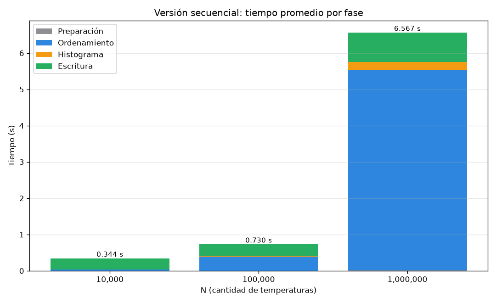
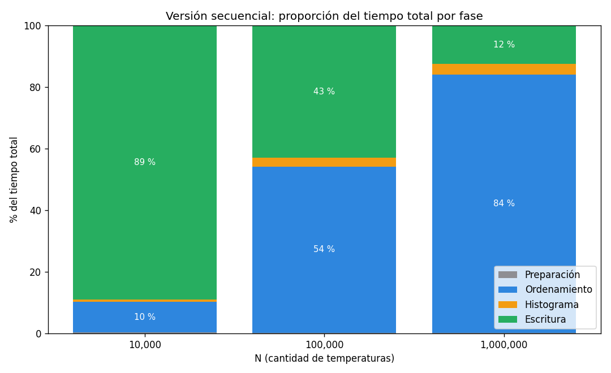
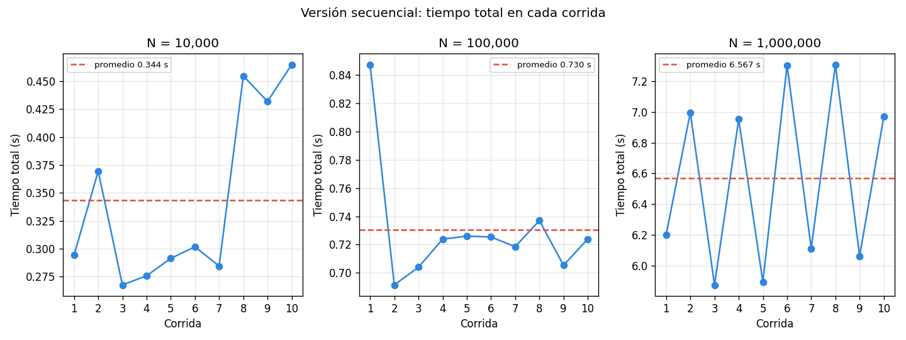

# Paso 2. Medición del tiempo de ejecución secuencial

> Responsable: Marinés García · Código: `secuencial/histograma_seq.py`, `benchmarks/run_benchmarks.py`
> Datos: `resultados/tiempos_secuencial.csv` (crudos), `resultados/resumen_secuencial.csv`, `resultados/entorno_secuencial.json`

## 2.1 Procedimiento

**Entorno.** Todas las mediciones (secuenciales y paralelas) se hacen en una **máquina virtual de
Google Colab con GPU T4**, para que la comparación del speedup sea justa. Los datos de la máquina
se registran automáticamente en `resultados/entorno_secuencial.json`:

| Característica | Valor |
|---|---|
| CPU | x86_64, **1 núcleo físico / 2 núcleos lógicos** |
| RAM | 13.6 GB |
| Python | 3.13.16 |
| Sistema | Linux 6.6.159 (x86_64, glibc 2.39) |
| Fecha de la medición | 13/11/2026, 15:00 |

**Datos.** Las temperaturas se generan con la misma fórmula del programa original
(`-100 + k/100`, con k entero aleatorio en [0, 20000]), pero con **semilla fija (2026)** en lugar de
`srand(time(NULL))`. Así cada corrida, y también la versión CUDA, procesa exactamente el mismo
conjunto de datos.

**Tamaños.** N = 10,000, 100,000 y 1,000,000 temperaturas. Cada vez el tamaño crece 10 veces,
para observar cómo escala cada fase.

**Fases medidas.** Cada corrida mide por separado, con `time.perf_counter()` (reloj monotónico de
alta resolución):

| Fase | Qué incluye |
|---|---|
| Preparación | Generar las N temperaturas |
| Ordenamiento | Copiar el arreglo + MergeSort recursivo |
| Histograma | Calcular los límites + recorrido de las 100 cubetas |
| Escritura | Escribir el CSV, el `.dat` y el `.png` |
| Total | Desde el inicio de la preparación hasta el final de la escritura |

**Repeticiones.** Por cada N se hacen **11 corridas bajo las mismas condiciones**:

- La **corrida 0 es de calentamiento (warm-up)** y no entra al promedio. En Colab, la corrida de
  calentamiento con N = 10⁴ tardó **0.65 s** en la escritura, más del doble que el promedio de las
  demás (0.31 s), porque ahí se carga matplotlib por primera vez y las cachés del sistema están
  frías. Con N = 10⁶, el warm-up tardó 8.04 s en total, contra un promedio de 6.57 s.
- Con las **10 corridas restantes** se calcula el promedio, la desviación estándar, la mediana y el
  coeficiente de variación (CV = desviación / promedio).
- Antes de cada corrida se ejecuta `gc.collect()`, para que la basura de la corrida anterior no
  provoque una recolección de memoria a mitad de la medición.
- En cada corrida se valida que el histograma sume N. Si una corrida da un resultado incorrecto,
  el benchmark se detiene.

**Comandos ejecutados en Colab:**

```python
!git clone -b marines/secuencial https://github.com/NESHGP04/proyecto3-PL.git
%cd proyecto3-PL
!pip install -q -r requirements.txt
!python -m tests.test_secuencial                     # validación previa
!python -m benchmarks.run_benchmarks --modo seq      # 3 tamaños × (1 + 10) corridas
!python -m benchmarks.run_benchmarks --modo graficas # tablas y figuras
```

## 2.2 Resultados

**Tabla 1.** Tiempo promedio ± desviación estándar por fase (segundos, 10 corridas).

| N | Preparación (s) | Ordenamiento (s) | Histograma (s) | Escritura (s) | Total (s) |
|---|---|---|---|---|---|
| 10,000 | 0.0010 ± 0.0003 | 0.0344 ± 0.0097 | 0.0023 ± 0.0006 | 0.3059 ± 0.0724 | 0.3436 ± 0.0791 |
| 100,000 | 0.0016 ± 0.0003 | 0.3942 ± 0.0430 | 0.0208 ± 0.0004 | 0.3137 ± 0.0116 | 0.7303 ± 0.0433 |
| 1,000,000 | 0.0099 ± 0.0019 | 5.5106 ± 0.5828 | 0.2313 ± 0.0039 | 0.8153 ± 0.0241 | 6.5672 ± 0.5892 |

**Tabla 2.** Proporción del tiempo total que ocupa cada fase, y estabilidad de las mediciones.

| N | % Preparación | % Ordenamiento | % Histograma | % Escritura | Mediana del total (s) | CV del total | Corridas |
|---|---|---|---|---|---|---|---|
| 10,000 | 0.3 % | 10.0 % | 0.7 % | 89.0 % | 0.2981 | 23.0 % | 10 |
| 100,000 | 0.2 % | 54.0 % | 2.9 % | 43.0 % | 0.7239 | 5.9 % | 10 |
| 1,000,000 | 0.2 % | 83.9 % | 3.5 % | 12.4 % | 6.5763 | 9.0 % | 10 |



*Figura 2. Tiempo promedio por fase para cada tamaño de N.*



*Figura 3. Porcentaje del tiempo total que ocupa cada fase.*



*Figura 4. Tiempo total de cada una de las 10 corridas. La línea punteada es el promedio.*

## 2.3 Análisis de los tiempos

**El ordenamiento es el cuello de botella cuando N es grande.** Con N = 10⁶, MergeSort tarda en
promedio **5.51 s, el 83.9 % del tiempo total**. Eso coincide con el conteo del Paso 1: MergeSort
hace casi 59 millones de operaciones elementales y 2 millones de llamadas recursivas, mientras que
el histograma hace ~1 millón de iteraciones y tarda 0.23 s (3.5 %).

**Cómo escala cada fase.** Al multiplicar N por 10:

| Fase | 10⁴ → 10⁵ | 10⁵ → 10⁶ | Crecimiento esperado |
|---|---|---|---|
| Ordenamiento | ×11.5 | ×14.0 | ×12.5 y ×12.0 (N·log₂N) |
| Histograma | ×9.0 | ×11.1 | ×10 (N) |
| Escritura | ×1.0 | ×2.6 | ×10 (N) + costo fijo |

- El **ordenamiento** crece más que lineal, como se espera de O(N·log₂N). Al pasar a 10⁶ crece
  más de lo que predice la teoría (×14.0 contra ×12.0). Esto indica que, a ese tamaño, los datos
  ya no caben en la caché y el costo por operación aumenta (ver factor 3).
- El **histograma** crece prácticamente lineal (~×10), como se espera de O(N + CUBETAS).
- La **escritura** casi no cambia entre 10⁴ y 10⁵ (0.31 s en ambos casos), porque dominan los
  costos fijos de generar la gráfica PNG y abrir los archivos (~0.3 s). Por eso, con N = 10⁴ la
  escritura es el **89 %** del total: con tamaños pequeños, paralelizar el cálculo casi no tendría
  impacto en el tiempo total.
- La **preparación** es despreciable en todos los tamaños (≤ 0.3 %), porque la generación de
  números aleatorios se hace por bloques con NumPy en ambas versiones, para garantizar que procesen
  los mismos datos.

**Estabilidad de la medición.**

- **N = 10⁵:** CV de 5.9 %. Las mediciones son estables, salvo la corrida 1 (0.85 s, con un
  ordenamiento de 0.51 s contra ~0.38 s en las demás), que probablemente todavía arrastraba efectos
  del calentamiento. El promedio (0.730 s) casi coincide con la mediana (0.724 s).
- **N = 10⁴:** CV de 23 %. La variación viene de la escritura (entre 0.24 y 0.42 s), que depende
  del disco compartido de Colab. En la Figura 4 se ve un salto en las corridas 8 a 10 (de ~0.29 s
  a ~0.45 s). En la corrida 8 solo se alentó la escritura, pero en la 9 y la 10 se alentaron
  todas las fases a la vez (el ordenamiento pasó de ~0.028 s a ~0.052 s). Eso indica que la
  máquina virtual tuvo más carga externa en ese momento, no un cambio del programa. En términos absolutos
  son décimas de segundo; por eso la mediana (0.298 s) describe mejor el tiempo típico que el
  promedio (0.344 s).
- **N = 10⁶:** CV de 9.0 %, con un patrón llamativo en el ordenamiento (Figura 4). Las corridas
  impares tardaron entre **4.85 y 5.16 s** y las pares entre **5.92 y 6.25 s**, alternándose de
  forma regular. El histograma y la escritura no muestran ese patrón (CV < 3 %). No se pudo
  determinar la causa exacta. Lo más probable es que sea el entorno compartido de Colab (el único
  núcleo físico se comparte con otros procesos de la máquina virtual) o el estado de la memoria al
  liberar y volver a reservar las listas de 10⁶ elementos entre corridas. En cualquier caso, el
  promedio (6.567 s) y la mediana (6.576 s) prácticamente coinciden, así que el promedio es
  representativo para calcular el speedup.

**Factores que influyen en el rendimiento:**

1. **Intérprete de Python.** Cada comparación, asignación e índice del MergeSort pasa por el
   intérprete, sin compilarse a código máquina como en C. Por eso la línea base mide el algoritmo
   secuencial en Python, que es contra lo que se compara la versión CUDA (también escrita en
   Python).
2. **Recursión.** MergeSort hace 2N − 1 llamadas a función (1,999,999 para N = 10⁶). En Python,
   cada llamada crea un marco de pila, lo que agrega un costo fijo por llamada que no existe en la
   versión iterativa de la GPU.
3. **Acceso a memoria y caché.** `merge` lee las dos mitades y escribe en `aux` de forma
   secuencial, lo cual aprovecha bien la caché. Pero con N = 10⁶ el arreglo y el auxiliar ocupan
   decenas de MB como listas de Python (cada `float` es un objeto aparte en memoria), y en los
   niveles altos de la recursión aumentan los accesos a RAM. Esto explica por qué el ordenamiento
   creció ×14.0 en lugar de ×12.0.
4. **Entrada/salida.** La escritura depende de convertir cada número a texto, de la generación de
   la gráfica (costo fijo de ~0.3 s) y del disco de la máquina virtual de Colab, que es compartido.
   Fue la fase con más variación cuando N es pequeño.
5. **Hardware de Colab.** La máquina tiene **1 núcleo físico con 2 hilos (2 núcleos lógicos)**.
   El mismo programa tardó ~4 veces más en el ordenamiento que en una laptop moderna (prueba
   preliminar: 1.30 s contra 5.51 s con N = 10⁶). Además, esto limita lo que puede ganar la fase de
   CPU paralela: con un solo núcleo físico, `multiprocessing` puede aprovechar como mucho 2 hilos
   que comparten el mismo núcleo.
6. **Ruido del entorno.** Colab es una máquina virtual compartida: otros procesos, la recolección
   de memoria de Python y el escalado de frecuencia del CPU producen variaciones entre corridas,
   como el patrón alternado con N = 10⁶. Por eso se usa warm-up, 10 repeticiones y se reportan la
   desviación y la mediana.
