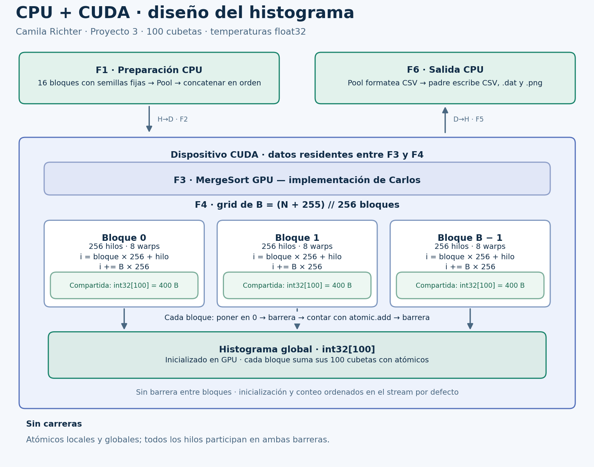

# Paso 4. Diseño del algoritmo paralelo

**Responsable: Camila Richter (23183).** Se describe la contribución CPU e histograma y su conexión con el pipeline del equipo.



Versión vectorial: [04_arquitectura_camila.svg](figuras/04_arquitectura_camila.svg).

## 1. Preparación en CPU

`preparar_datos(n, procesos=None)` obtiene los pares `(semilla_hija, tamaño)` de `semillas_bloques(n)`, ejecuta `generar_bloque` con `Pool.starmap` y concatena en ese mismo orden. Devuelve un vector `float32` de tamaño N. Cada trabajador escribe su propio bloque, sin compartir contadores ni usar locks.

El número efectivo de trabajadores es el menor entre los procesos solicitados —por defecto `os.cpu_count()`— y la cantidad de tareas. Esto evita crear más trabajadores que bloques. La disponibilidad de vCPU en Colab se documenta en el entorno de ejecución (`resultados/entorno_cuda.json`); disponer de muchos bloques no significa disponer de muchos núcleos físicos.

N negativo y procesos menores que uno se rechazan. Para N = 0 se devuelve un vector vacío. El uso desde un script está protegido con `if __name__ == "__main__":` para permitir el método `spawn`, utilizado en macOS. Las funciones de workers están definidas en el módulo y no son lambdas.

## 2. Interfaz y configuración CUDA

La interfaz conservada es `histograma_gpu(d_ordenado, minimo, maximo)`. Recibe el vector `float32` ya residente en el dispositivo y devuelve un vector de dispositivo `int32[100]`. Los extremos son escalares del host entregados por el pipeline. Esta función procesa directamente sobre el dispositivo y no obtiene los extremos leyendo el arreglo desde el host.

Con **T = 256 hilos por bloque**, se usa:

\[
B = \left\lceil \frac{N}{256} \right\rceil
  = (N + 255)\mathbin{//}256.
\]

| N | Bloques B | Hilos lanzados B × 256 |
|---:|---:|---:|
| 10 000 | 40 | 10 240 |
| 100 000 | 391 | 100 096 |
| 1 000 000 | 3 907 | 1 000 192 |
| 10 000 000, opcional | 39 063 | 10 000 128 |

Cada bloque tiene ocho warps de 32 hilos y utiliza **100 × 4 = 400 bytes** de memoria compartida para sus contadores. Es una configuración inicial razonable, no una afirmación de que 256 sea óptimo sin medir. El histograma global ocupa otros 400 bytes en el dispositivo.

El grid-stride loop es:

```python
i_inicial = cuda.grid(1)
salto = cuda.gridsize(1)
for i in range(i_inicial, datos.size, salto):
    # Clasificar datos[i] y sumar a hist_local.
    ...
```

Con el grid elegido, cada hilo procesa como máximo una temperatura. El mismo kernel permite reducir el grid y hacer que cada hilo recorra varios elementos; la prueba de grid-stride usa dos bloques de 32 hilos para 2 049 datos. Los hilos cuyo índice queda fuera de N no cuentan elementos, pero participan en ambas barreras.

## 3. Conteo por bloque y prevención de carreras

1. Reservar `hist_global` en GPU y ponerlo en cero con un kernel de inicialización. No copiar un vector de ceros desde CPU.
2. Cada bloque reserva `cuda.shared.array(CUBETAS, int32)`. Los hilos inicializan sus 100 posiciones mediante un recorrido con salto `blockDim.x`.
3. Todos los hilos del bloque ejecutan `cuda.syncthreads()`.
4. Cada hilo calcula la cubeta de sus temperaturas y actualiza `hist_local` mediante `cuda.atomic.add`.
5. Todos los hilos del bloque ejecutan la segunda `cuda.syncthreads()`.
6. Los hilos suman las 100 frecuencias locales al histograma global con `cuda.atomic.add`.

| Riesgo | Solución |
|---|---|
| Usar memoria compartida sin inicializar | Poner todos sus contadores en cero y ejecutar la primera barrera. |
| Varios hilos actualizan una misma cubeta local | Suma atómica en memoria compartida. |
| Publicar una cuenta local todavía incompleta | Segunda barrera antes de sumar al global. |
| Varios bloques actualizan una misma cubeta global | Suma atómica global. |
| Bloque incompleto al final del arreglo | Condición del loop; no retornar antes de las barreras. |
| Reutilizar basura o cuentas de una llamada anterior | Inicializar un nuevo histograma global en cada llamada. |

Los dos kernels se lanzan en el stream por defecto, que preserva su orden. No se coloca `cuda.synchronize()` dentro de la función: el pipeline se encarga de sincronizar al medir y antes de consumir resultados en CPU. Una barrera de bloque no sincroniza todo el grid.

El conteo realiza N sumas atómicas locales y B × 100 sumas atómicas globales, frente a N globales si se actualizara directamente el histograma. Hay además inicializaciones y barreras. Para datos concentrados en pocas cubetas todavía existe contención local; el beneficio se determina con pruebas, no solo con el número de atómicos.

## 4. Cubetas, precisión y casos especiales

Para `ancho = (maximo - minimo) / 100`, la cubeta c corresponde al intervalo `[minimo + c*ancho, minimo + (c+1)*ancho)`. La última incluye el máximo. Se estima `c = int((x - minimo) / ancho)`, se acota a `[0, 99]` y se compara con los límites vecinos para corregir cocientes casi enteros por redondeo.

El almacenamiento de temperaturas sigue siendo `float32`; los escalares, el cociente y los límites se calculan en doble precisión. Esta decisión reduce ambigüedades de frontera y se coordinó con la implementación secuencial de Marinés para garantizar consistencia. Las pruebas comparan contra un oráculo que busca límites con `np.searchsorted`, y también contra la implementación secuencial de referencia de Marinés, validando identidad exacta en las 100 cubetas. La coincidencia en una GPU real se estableció como comprobación obligatoria antes de medir.

Si mínimo y máximo coinciden, se evita dividir por cero y se asignan todas las muestras a la cubeta 0. Si N = 0, solo se devuelve el histograma inicializado con extremos finitos de convenio (ambos cero). Se rechazan N mayores que `2**31 - 1`, porque las frecuencias son `int32`. Los datos válidos son temperaturas finitas, y los extremos deben corresponder al vector completo.

## 5. Escritura en CPU

`escribir_resultados(ordenado, hist, carpeta_salida="resultados", procesos=None)` recibe los resultados en CPU. El Pool solo formatea el CSV en cadenas. `imap` devuelve los bloques en orden y el padre escribe el encabezado `Indice,Temperatura` y las filas con índices desde cero y dos decimales.

El mismo padre crea `histograma.dat`, con 100 líneas de límite inferior y frecuencia, y `histograma.png`, con Matplotlib y el backend Agg. Se conserva el formato ejecutado por el C: aunque su comentario dice “valor central”, el programa realmente escribe `minimo + i*ancho`. No se modifica el código original. Para N vacío se usan los límites de configuración únicamente para dibujar la salida vacía.

## 6. Integración y medición

La integración del pipeline híbrido (`paralelo/histograma_cuda.py`) consume directamente las funciones de CPU y GPU sin alterar sus firmas. Las fases en CPU (F1 y F6) se miden de extremo a extremo alrededor de las llamadas completas con `perf_counter()`. En la GPU, el costo de inicializar el histograma en memoria de video queda incluido dentro de F4. Los eventos de hardware de CUDA (`cuda.event`) cronometran con precisión tanto la inicialización como el conteo en silicio, sincronizándose con `synchronize()` antes de registrar el tiempo transcurrido. La reserva de memoria y otros costos de coordinación en el host quedan reflejados en el tiempo de pared total del pipeline.

La medición y registro de tiempos se centraliza en el pipeline y en los benchmarks desarrollados por Carlos. La fase F2 mide la transferencia del arreglo de entrada desde la CPU hacia la GPU (H→D). La lectura de los valores extremos (mínimo y máximo) desde el arreglo ya ordenado en GPU se realiza de forma escalar y su latencia queda absorbida en el pipeline. Por último, F5 contabiliza las transferencias de salida hacia el host (D→H) correspondientes al arreglo ordenado y al histograma de 100 cubetas para su persistencia en disco.

## Referencias

- [API oficial de Numba CUDA](https://nvidia.github.io/numba-cuda/reference/kernel.html): arreglos compartidos, indexación, atómicos y barreras.
- [Documentación del simulador](https://nvidia.github.io/numba-cuda/user/simulator.html): depuración y límites de validación sin GPU.
