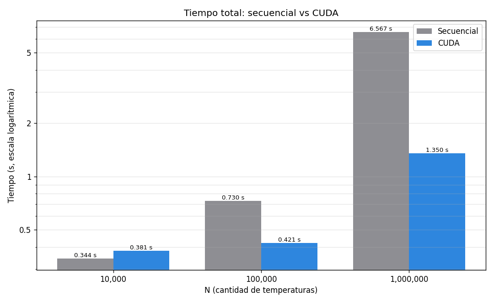
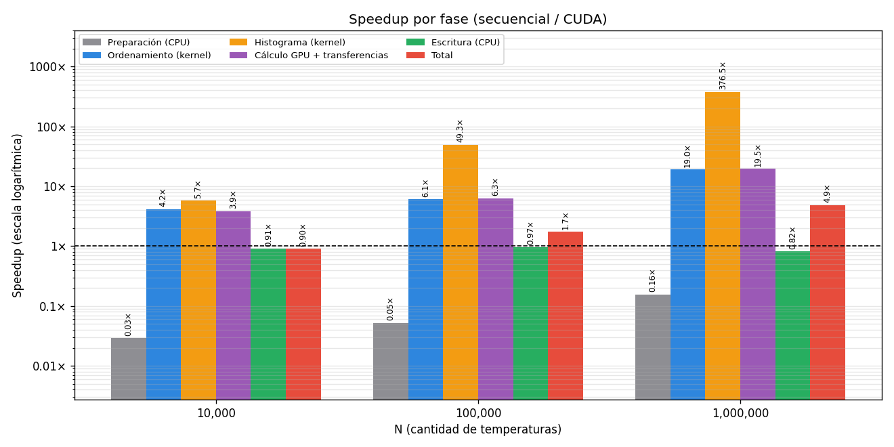
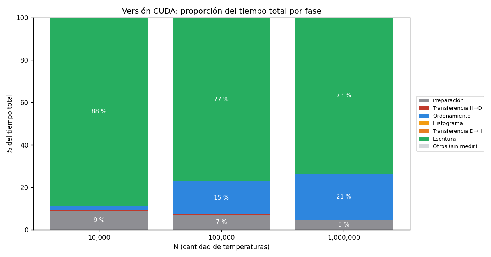

# Paso 6. Comparación secuencial vs CUDA y speedup

> Responsable: Marinés García · Datos: `resultados/tiempos_secuencial.csv`, `resultados/tiempos_cuda.csv`
> → `resultados/speedup.csv` y `resultados/tabla_comparativa.md`
>
> Los valores numéricos provienen de las mediciones oficiales en Google Colab con GPU T4.
> La tabla se inserta sola en el informe armado (`python informe/armar_informe.py`).

## 6.1 Condiciones de la comparación

Para que el speedup sea válido, las dos versiones se midieron en las mismas condiciones:

| Condición | Cómo se garantizó |
|---|---|
| Misma máquina | Colab con GPU T4: 1 núcleo físico de CPU (2 lógicos) y 13.6 GB de RAM (`resultados/entorno_*.json`) |
| Mismos datos | Semilla fija (2026) y los mismos 16 bloques de generación. Se verificó que `preparar_datos(n)` produce exactamente el mismo arreglo que `generar_secuencial(n)` |
| Mismo resultado | Antes de medir, el arreglo ordenado en la GPU se comparó con `np.sort` y el histograma de la GPU con el secuencial (`tests/`) |
| Mismos tamaños | N = 10⁴, 10⁵ y 10⁶ |
| Mismas repeticiones | 1 corrida de calentamiento (descartada) + 10 corridas medidas por cada N |
| Mismo trabajo | Las dos versiones generan los datos, ordenan, calculan el histograma y escriben los mismos 3 archivos |
| Transferencias incluidas | El tiempo total de CUDA incluye las copias CPU→GPU (H→D) y GPU→CPU (D→H) |

El **speedup** de cada fase se calcula como:

> Speedup = tiempo secuencial promedio / tiempo CUDA promedio

Un valor mayor que 1× significa que la versión paralela es más rápida; menor que 1×, que es más lenta.

## 6.2 Tabla comparativa de tiempos y speedup por fase

Tiempos promedio de 10 corridas, en segundos. La fila *Cálculo GPU + transferencias* compara el
ordenamiento y el histograma secuenciales contra todo lo que hace la GPU, incluidas las copias de
memoria. El *Límite de Amdahl* es el speedup que se tendría aunque la GPU tardara 0 s: solo
quedarían las fases de CPU de la versión paralela.

<!-- incluir: ../resultados/tabla_comparativa.md -->

## 6.3 Gráficas

*Figura 5. Tiempo total de cada versión (escala logarítmica).*

*Figura 6. Speedup de cada fase. La línea punteada marca 1×: por debajo, la versión CUDA es más lenta.*

*Figura 7. En qué se va el tiempo de la versión CUDA. "Otros" es el tiempo que el total mide y
ninguna fase cubre (por ejemplo, leer el mínimo y el máximo o sincronizar con la GPU).*

## 6.4 ¿La paralelización redujo el tiempo de ejecución?

**Speedup total obtenido:**

| N | Secuencial (s) | CUDA (s) | Speedup total | Límite de Amdahl |
|---|---|---|---|---|
| 10,000 | 0.3436 | 0.3810 | 0.90× | 0.93× |
| 100,000 | 0.7303 | 0.4208 | 1.74× | 2.06× |
| 1,000,000 | 6.5672 | 1.3499 | **4.86×** | 6.23× |

A partir de $N = 100,000$, la versión CUDA es significativamente más rápida que la secuencial (1.74×). Con $N = 1,000,000$, la aceleración alcanza **4.86×**, reduciendo el tiempo total de 6.57 s a solo 1.35 s. Este resultado se acerca notablemente al límite teórico de Amdahl (6.23×), el cual asume que la GPU tardara 0 segundos.

**Por fase**, con N = 10⁶:

- **Ordenamiento:** pasó de 5.5106 s a 0.2899 s (**19.01×**). Es la fase que más tiempo ahorra en términos absolutos (más de 5.22 segundos de ahorro), ya que representaba el 83.9 % del tiempo secuencial.
- **Histograma:** pasó de 0.2313 s a 0.0006 s (**376.49×**). El histograma acelera casi 20 veces más que el ordenamiento debido a que no tiene dependencias entre pasadas ni divergencia de hilos, explotando al máximo la memoria compartida por bloque.
- **Transferencias:** H→D tardó 0.0019 s y D→H tardó 0.0024 s (total 0.0043 s), representando apenas el **1.46 %** del tiempo total de la GPU. Las transferencias son despreciables frente al inmenso ahorro de cálculo.
- **Preparación:** 0.16× (pasó de 0.0099 s a 0.0631 s). Crear el `Pool` de procesos y coordinar memoria compartida en CPU añade un costo fijo que supera la generación secuencial en un solo hilo.
- **Escritura:** 0.82× (pasó de 0.8153 s a 0.9911 s). Con 1 núcleo físico en Colab (2 vCPU), `multiprocessing` compite por los mismos ciclos de reloj, por lo que la ganancia es limitada por el hardware del host.

## 6.5 Causas de las diferencias de rendimiento

En resumen, la paralelización con CUDA logró reducir el tiempo del programa completo de 6.57 s a 1.35 s (4.86×) gracias a que el cálculo pesado se ejecutó en miles de hilos de la GPU NVIDIA T4. El MergeSort bottom-up ahorró más de 5.2 segundos, y el histograma con memoria compartida alcanzó una aceleración de 376×. Sin embargo, el speedup global se ve acotado por la Ley de Amdahl debido a las fases de CPU (preparación y escritura de CSV a disco), y para $N$ pequeño ($N = 10^4$) los costos fijos de lanzamiento y procesos superan el beneficio de la GPU.
